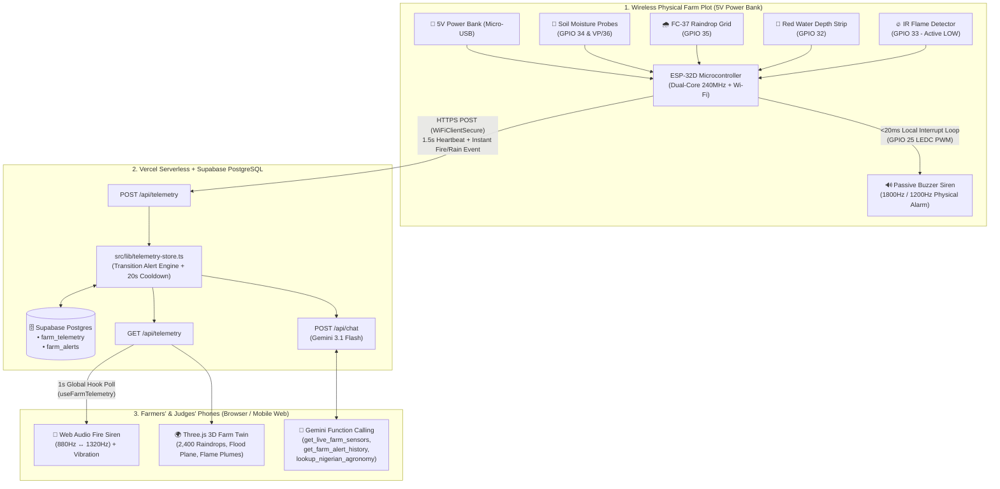
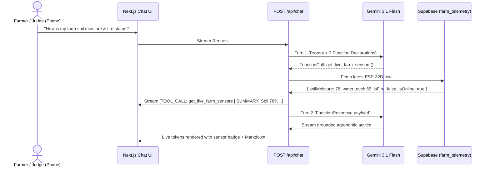

# 🏗️ El Niño — Cyber-Physical System Architecture

**Team:** El Nino Team 8 (Buildathon Group 8)  
**Live Deployment:** `https://elnino-three.vercel.app`  
**Repository:** `https://github.com/prince24-web/el-nino`

---

## 1. Architectural Philosophy

**El Niño** is designed as a **closed-loop Cyber-Physical System (CPS)** unifying three layers:
1. **Autonomous Edge IoT Node (ESP-32D + 5 Farm Sensors + Physical Passive Buzzer)** — Runs wirelessly off a 5V USB power bank, reacts locally to wildfires in `<20ms` (`1800Hz/1200Hz` PWM siren), and pushes live readings to the cloud over Wi-Fi HTTPS.
2. **Serverless Cloud & Persistence Layer (Next.js 16 on Vercel + Supabase PostgreSQL)** — Solves serverless instance isolation by persisting real-time telemetry and hazard logs in PostgreSQL (`farm_telemetry`, `farm_alerts`), enabling simultaneous multi-client sync across laptops and judges' mobile phones.
3. **Multimodal AI & 3D Digital Twin Layer (Google Gemini 3.1 Flash + Three.js WebGL)** — Gives farmers both a real-time 3D visualization of their plot and an AI agronomy assistant capable of **native tool calling** against live physical sensors.

---

## 2. End-to-End System Topology

---

## 3. Why Supabase Persistence Matters for Vercel Serverless

In a traditional single-process Node server (`localhost`), holding telemetry in an in-memory variable works because every browser shares one process. On **Vercel Serverless**, incoming requests (`POST /api/telemetry` from the ESP32 and `GET /api/telemetry` from judges' phones) can be routed to **isolated, ephemeral function containers** that do not share RAM.

| Requirement | In-Memory Only | El Niño Hybrid (`telemetry-store.ts` + Supabase) |
| :--- | :--- | :--- |
| **Multi-device sync on Vercel** | ❌ Judges' phones see empty state | ✅ All phones read the exact same live PostgreSQL row |
| **Zero-latency local fallback** | ✅ Instant RAM read | ✅ Automatic in-memory fallback if offline/unconfigured |
| **Historical audit trail** | ❌ Lost on restart | ✅ Transition events (`WILDFIRE`, `FLOOD`, `RAIN`, `DROUGHT`) logged in `farm_alerts` |
| **AI historical reasoning** | ❌ Present snapshot only | ✅ Gemini calls `get_farm_alert_history()` for time-series context |

---

## 4. Gemini Live Sensor Tool-Calling Sequence

When a farmer or judge asks *"How is the soil moisture on my farm right now?"*, the assistant does not guess — it executes a live hardware read via Gemini Function Calling:

---

## 5. Latency & Reliability Engineering

| Path | Target Latency | Fault Tolerance Mechanism |
| :--- | :--- | :--- |
| **Flame Sensor $\rightarrow$ Physical Buzzer** | **`< 20 ms`** | Non-blocking `millis()` loop runs locally on ESP32; works even with **zero Wi-Fi**. |
| **Flame Sensor $\rightarrow$ Judges' Phones** | **`~1.0 – 1.8 s`** | Event-driven `POST` triggers immediately on state transition + 1s frontend poll. |
| **Phone Browser Audio Playback** | **Instant** | Pure Web Audio API oscillator synthesis (`alarm-audio.ts`) avoids network MP3 fetch delays; arms via 1-tap header pill or any touch gesture. |
| **Stage Demo Failsafe** | **Instant** | Built-in **Backup Sliders** in `FarmSimulation3D` can inject test readings into `/api/telemetry` if venue Wi-Fi blocks outbound ESP32 traffic. |
